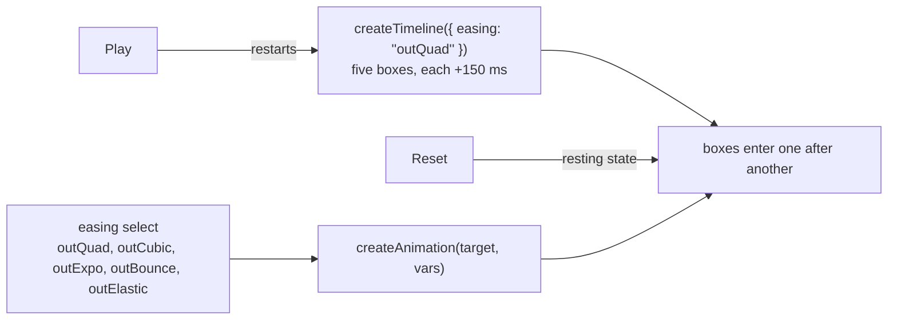

# Demo

The demo lives at [https://shijianjs.github.io/ktjs-anime/demo/](https://shijianjs.github.io/ktjs-anime/demo/).

The demo page runs two real animations built through the wrapper: a timeline in which five boxes
enter one after another, each 150 ms after the previous one, and a single tween whose easing comes
from the select (`outQuad`, `outCubic`, `outExpo`, `outBounce`, `outElastic`). Play restarts the
timeline and the reset button returns every box to its resting state.

Both examples are the same wrapper surface: a target, a variables record, and a timeline that owns the
order.

The language button in the page header switches between English and Simplified Chinese: every
visible string changes, not just the title.

The API reference is at [https://shijianjs.github.io/ktjs-anime/api/](https://shijianjs.github.io/ktjs-anime/api/), generated by Dokka from the published modules.
