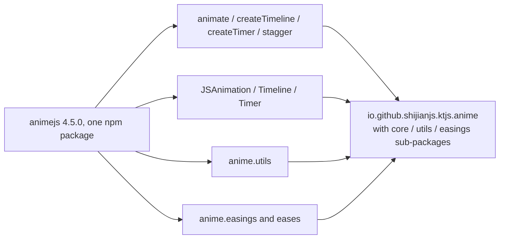

# Introduction

`ktjs-anime` is a Kotlin/JS wrapper for [`animejs`](https://github.com/juliangarnier/anime) from [anime.js](https://github.com/juliangarnier/anime) 4.5.0: every type and member of
the upstream `.d.ts` files becomes an `external` declaration the compiler checks, with no
`dynamic` fallback.

The wrapped surface is the animation core of the `animejs` 4 package: `animate()`, `createTimeline()`, `createTimer()`, `stagger()`, the `JSAnimation` / `Timeline` / `Timer` class hierarchy with its typed parameter objects, `anime.utils` (number, target and time helpers) and `anime.easings` (the easing factories plus the `eases` set).

## What is wrapped

| Module | Gradle artifact | Upstream |
| --- | --- | --- |
| `ktjs-anime` | `io.github.shijianjs:ktjs-anime` | `animejs` 4.5.0 (one npm package) |

One npm package means one Kotlin package (`io.github.shijianjs.ktjs.anime`) with sub-packages, not one Gradle module per upstream sub-directory.

## License

The wrapper itself is MIT. The upstream `animejs` license differs from it — read the
[license notes](guide/license.md) before shipping it commercially.

## Where to go next

- [Getting started](guide/getting-started.md) — add the dependency, make the first call, run the build.
- [API overview](guide/api-overview.md) — package layout, type mapping conventions, common patterns.
- [Demo](guide/demo.md) — see it running in the browser.
