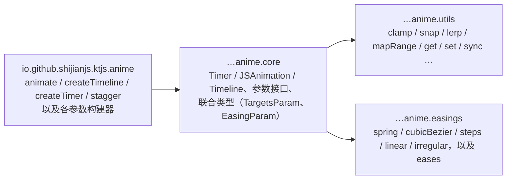

# API 概览

## 包结构

| 包 | 内容 |
| --- | --- |
| `io.github.shijianjs.ktjs.anime` | `AnimeNamespace` 导入、`animate`、`createTimeline`、`createTimer`、`stagger`，以及参数构造器 `animationParams` / `timelineParams` / `timerParams` / `staggerParams` |
| `…anime.core` | `Timer`、`JSAnimation`、`Timeline`，它们的参数接口（`TimerParams`、`AnimationParams`、`TimelineParams`、`DefaultsParams`、`StaggerParams`），联合类型（`TargetsParam`、`EasingParam`、`TimelinePosition`、`TweenParamValue`）与 `property` / `tweenKeyValue` |
| `…anime.utils` | `anime.utils`：`clamp`、`round`、`snap`、`wrap`、`lerp`、`damp`、`mapRange`、`degToRad`、`radToDeg`、`random`、`randomPick`、`shuffle`、`get`、`set`、`remove`、`sync` |
| `…anime.easings` | `anime.easings`（`spring`、`cubicBezier`、`steps`、`linear`、`irregular`）与 `eases` 集合 |

## 本 wrapper 的约定

- 联合类型 = 一个不透明接口 + 每个分支一个同名工厂：`TargetsParam("#app")`、
  `TargetsParam(Target(element))`、`TargetsParam(arrayOf(…))`、`EasingParam("outQuad")`、
  `TimelinePosition(500.0)` / `TimelinePosition("+=200")`、`TweenParamValue(800.0)`。
- 参数对象用 `unsafeJso` 构造器。被动画的属性名属于索引签名，所以走 `property(name, value)`，
  而不是 Kotlin 字段。
- 上游的「可选参数」用重载而不是 `null`：anime.js 用 `= {}` 解构参数对象，传 `null` 会抛错。
  因此 `createTimeline()` / `createTimer()` 以零参数调用同一个 JavaScript 函数。
- 上游写成 getter/setter 对的成员在这里就是普通 `var` —— JavaScript 里一对访问器本来就是一个属性。
- `external` 类不能把父类成员收窄重声明（除非父类成员是 `open`）；`stretch`、`revert`、`then`
  在 `Timer` 上声明为 `open`，让 `JSAnimation` 与 `Timeline` 能返回自身类型。

## 有意放宽的类型

| 成员 | Kotlin 类型 | 原因 |
| --- | --- | --- |
| `AnimationParams.keyframes` | `JsAny` | 上游是 `PercentageKeyframes \| DurationKeyframes`，两种记录形状的联合 |
| `AnimationParams.modifier` / `StaggerParams.modifier` | `(Double) -> JsAny` | 上游返回 `number \| string` |
| `TimerParams.loop` / `autoplay` / `StaggerParams.seed` | `JsAny` | 上游把字面量联合与回调混在同一字段 |
| `utils.randomPick` / `shuffle` | `JsAny` / `Array<JsAny>` | 上游对元素类型是泛型的 |

每一条都记在 `docs/development/technical-decisions.md`。
