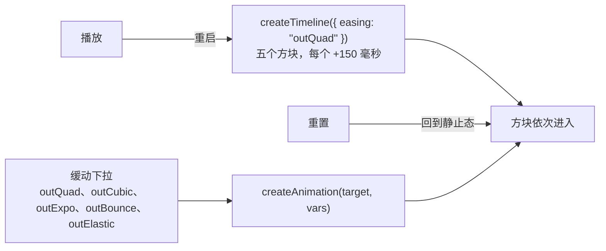

# 演示页

演示页：[https://shijianjs.github.io/ktjs-anime/demo/](https://shijianjs.github.io/ktjs-anime/demo/)

演示页跑两段由 wrapper 构造的真实动画：一条时间线里五个方块依次进入，每个比前一个晚 150 毫秒；
以及一条缓动由下拉框决定的补间（`outQuad`、`outCubic`、`outExpo`、`outBounce`、`outElastic`）。
播放按钮重启时间线，重置按钮把每个方块恢复到静止状态。

两个示例用的是同一个封装面：一个目标、一份变量记录，加一条负责顺序的时间线。

页面右上角的语言按钮在英文与简体中文之间切换，切换的是页面上全部可见文案（不只是页面标题）。

API 文档在 [https://shijianjs.github.io/ktjs-anime/api/](https://shijianjs.github.io/ktjs-anime/api/)，由 Dokka 从已发布模块生成。
