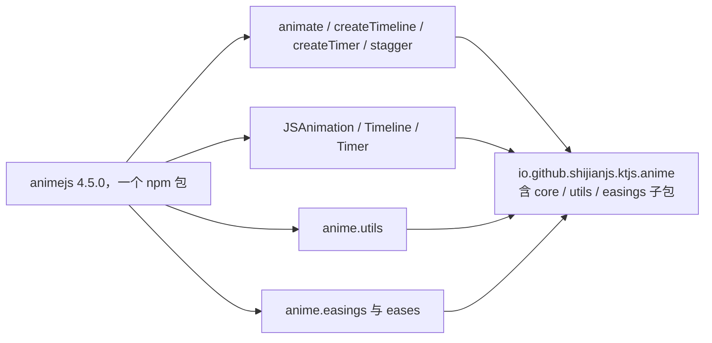

# 简介

`ktjs-anime` 是 [anime.js](https://github.com/juliangarnier/anime) 生态里 `animejs` 4.5.0 的 Kotlin/JS wrapper：上游
`.d.ts` 里的每个类型和成员都落成可被编译器检查的 `external` 声明，不靠 `dynamic` 兜底。

封装范围是 `animejs` 4 的动画核心：`animate()`、`createTimeline()`、`createTimer()`、`stagger()`、`JSAnimation` / `Timeline` / `Timer` 类层次及其带类型的参数对象、`anime.utils`（数字、目标与时间工具）、`anime.easings`（缓动工厂与 `eases` 缓动集合）。

## 封装了哪些包

| 模块 | Gradle 坐标 | 上游 |
| --- | --- | --- |
| `ktjs-anime` | `io.github.shijianjs:ktjs-anime` | `animejs` 4.5.0（单个 npm 包） |

一个 npm 包对应一个 Kotlin 包（`io.github.shijianjs.ktjs.anime`）及其子包，而不是每个上游子目录一个 Gradle 模块。

## 许可证

wrapper 自身是 MIT。上游 `animejs` 的许可证与 wrapper 不同，商用前请读
[许可证说明](guide/license.md)。

## 接下来

- [快速开始](guide/getting-started.md) — 加依赖、写第一个调用、跑构建。
- [API 概览](guide/api-overview.md) — 包结构、类型映射约定、常用写法。
- [演示页](guide/demo.md) — 浏览器里直接看效果。
